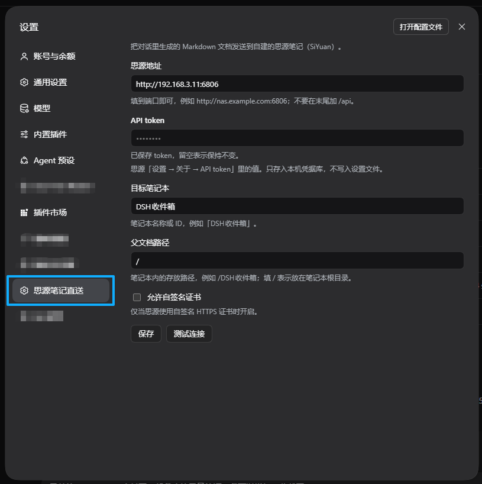
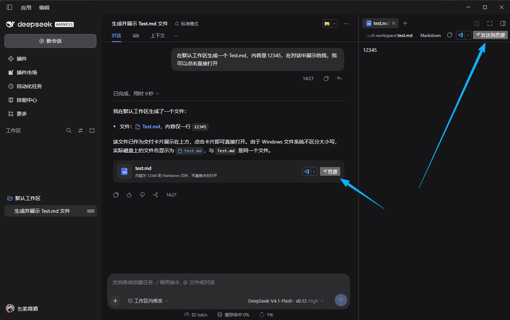

# 思源笔记直送 · dsh-siyuan-sender

把 DeepSeek Harness 对话里生成的 Markdown 文档，直接送进你自己部署的思源笔记（SiYuan）。

点一下文档卡片上的按钮，标题和正文就落进指定笔记本 —— 不用下载、不用复制粘贴、不用切窗口。

> 已在 SiYuan 3.8.8（Docker 部署、外网访问）实测通过。

---

## 功能

- **文档卡片按钮** —— 每份 `.md` 交付文件右侧多一个「思源」按钮，点即发送
- **预览工具栏按钮** —— 右侧边栏阅读 `.md` 时，标题栏也能发
- **给模型的工具** —— 直接说「把 xxx.md 发到思源」，Agent 自己调用 `siyuan_send`
- **可见的反馈** —— 点击按钮后会提示是否发送成功
- **绝不覆盖** —— 重名自动加时间戳，已有笔记不会被改写
- **绝无隐私问题** —— 数据仅存储在DSH本地，文档会发送到自定义思源笔记，绝无其他数据发送

## 安装

推荐方式：到 [Releases](https://github.com/baby7/dsh-siyuan-sender/releases) 下载最新的 `.tgz`，再指向文件安装：

```bash
dsh plugin --profile desktop add ./dsh-siyuan-sender-1.0.0.tgz
```

也可以让 pnpm 直接下载 Release 附件：

```bash
dsh plugin --profile desktop add https://github.com/baby7/dsh-siyuan-sender/releases/download/v1.0.0/dsh-siyuan-sender-1.0.0.tgz
```

或跟踪仓库主分支（不锁版本，随上游变化）：

```bash
dsh plugin --profile desktop add github:baby7/dsh-siyuan-sender
```

> `desktop` 是 DSH 桌面端的 profile 名；Web 端装的也是同一个 profile 目录，换成你实际使用的名字即可（`dsh plugin --profile <名字> add ...`）。

装好后刷新页面即可。

## 配置

需要三样东西：

| 项 | 从哪来 |
|---|---|
| **思源地址** | 到端口为止，如 `http://192.168.3.11:6806`（不要加 `/api`） |
| **API token** | 思源「设置 → 关于 → API token」 |
| **目标笔记本** | 笔记本名称或 ID，建议专建一个「DSH收件箱」 |

可选：**父文档路径**（笔记本内位置，`/` 表示根目录）；**允许自签名证书**（私有 HTTPS 才需要）。

> Token 只存进本机凭据库，不会写入设置文件，也不会发给浏览器。

设置 → **思源笔记直送**，填地址、Token、笔记本，点「测试连接」确认无误。



---


## 使用

对话里生成 `.md` 后，卡片右侧点「思源」；或在右侧预览里点「发送到思源」。成功会提示落入的路径。

也可以直接说：

```text
把 report.md 发送到思源
```



## 命名规则

标题取正文第一个 `#` 标题（没有则用文件名）。重名不覆盖，追加时间戳：

```text
/DSH收件箱/季度报告
/DSH收件箱/季度报告 2026-10-28 13:07
```

## 只支持 Markdown

扩展名白名单 `.md` / `.markdown` / `.mdown` / `.mdx`。图片不会一并上传，其它格式请用思源自带的导入功能。

## 出问题？

| 现象 | 处理 |
|---|---|
| 点按钮没反应 | 重装插件后**刷新页面** |
| Token 无效 | 重新从「设置 → 关于」复制 |
| 地址无响应 | 确认填的是思源内核地址，别带 `/api` |
| 找不到笔记本 | 提示会列出实际笔记本名，照抄一个 |
| 证书校验失败 | 勾选「允许自签名证书」 |
| 超时 | 调大配置里的 `timeoutMs`（最高 120000） |

---

## 发版（维护者）

仓库带了一条 GitHub Actions 流水线 `.github/workflows/release.yml`：推送 `v*` 标签即自动跑测试、校验包结构、打出 `.tgz` 并创建 Release。

```bash
# 1. 确认 package.json 的 version 与要打的标签一致，提交改动
git add -A && git commit -m "chore: release v1.0.0"
git push origin master

# 2. 打标签并推送，流水线随即启动
git tag v1.0.0
git push origin v1.0.0
```

也可以在 Actions 页手动触发该工作流（`workflow_dispatch`），并在输入框里指定标签。

流水线会先拒绝三类错误：标签与 `package.json` 版本不一致、`exports` 指向不存在的文件、打出的 tgz 里缺 `index.js` / `client.js` / `cordis.patch.yml`。发下一版时，把 `package.json` 的 `version` 改成新值再推对应的标签。

## 许可

[MIT](LICENSE) © 2026 baby7

**实现细节、设计取舍与安全模型**见 [设计说明.md](设计说明.md)。
